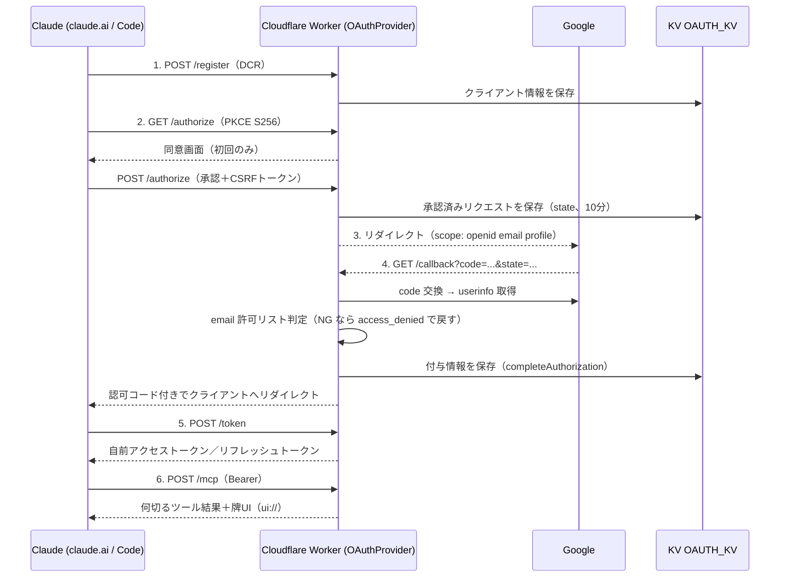

# 何切るMCP Cloudflare Workers移行 設計書

- 作成日: 2026-11-14
- 元ドキュメント: https://claude.ai/artifact/8SGGDJu9GNDXnHqAztKjDG（内容はこのファイルと同じ。以後の更新はこのファイルを正とする）
- 関連: [remote-mcp-google-oauth.md](./remote-mcp-google-oauth.md)（現行 Vercel 版の Google OAuth 設計）

## 概要

何切るMCP（`show_mahjong_hand`）を Cloudflare Workers に載せ、`workers-oauth-provider` で自前の認可サーバーを持つ。Vercel 版は残し、Workers 版が安定したら片方に寄せるか決める。

| 観点             | 今の Vercel 版                                      | Workers 版（本設計）                                           |
| ---------------- | --------------------------------------------------- | -------------------------------------------------------------- |
| 実行環境         | Next.js route handler（`mcp-handler`）              | Cloudflare Worker（`agents/mcp/server` の `createMcpHandler`） |
| 認可サーバー     | なし（Google が AS、MCP は Resource Server のみ）   | Worker 自身が AS。ログインだけ Google に委譲                   |
| アクセストークン | Google のトークンをそのまま使用                     | Worker が発行する自前トークン（KV にハッシュ保存）             |
| トークン検証     | 毎回 Google `tokeninfo` に問い合わせ＋TTLキャッシュ | ライブラリが KV で検証。外部問い合わせなし                     |
| クライアント登録 | Google OAuth クライアントIDを事前に用意             | DCR（`/register`）で自動登録。CIMD も将来有効化可              |
| 許可判定         | `aud` と `email` の許可リスト                       | `/callback` で email 許可リストを判定してから発行              |
| 牌UI（MCP Apps） | `ui://` で hand.html を配信                         | 同じ。hand.html をテキストとしてバンドル                       |
| シャンテン計算   | `nanikiru-core.ts`                                  | 同じファイルを import（単一ソース維持）                        |

スコープ外: stock-mcp、Vercel 版の削除、独自ドメイン。URL は `*.workers.dev`、許可するのは本人のメールアドレスのみ。

## 全体構成

Worker 1つが認可サーバーと MCP サーバーを兼ねる。Google は本人確認にだけ使い、MCP 用のトークンは Worker が発行する。

`/.well-known/oauth-authorization-server` と `/.well-known/oauth-protected-resource` はライブラリが自動で返す。

## 実装設計

MCP 部分はステートレスの `createMcpHandler` を使い、Durable Objects は使わない。何切るは状態を持たないので `McpAgent` は不要で、Cloudflare 公式の Google OAuth デモも同じ構成。

新規ディレクトリ `mcp-servers/mahjong-nanikiru-worker/`:

| ファイル                       | 責務                                                                                                                                                                                                                                             |
| ------------------------------ | ------------------------------------------------------------------------------------------------------------------------------------------------------------------------------------------------------------------------------------------------ |
| `wrangler.jsonc`               | Worker名 `mahjong-nanikiru`、`compatibility_flags: ["nodejs_compat", "global_fetch_strictly_public"]`、KV `OAUTH_KV`、vars `MCP_RESOURCE`、`.html` を Text として取り込む `rules`、`dev.port: 8788`                                              |
| `src/index.ts`                 | `new OAuthProvider({ apiRoute: "/mcp", apiHandler, defaultHandler: GoogleHandler, authorizeEndpoint: "/authorize", tokenEndpoint: "/token", clientRegistrationEndpoint: "/register", clientIdMetadataDocumentEnabled: true, resourceMetadata })` |
| `src/google-handler.ts`        | `GET/POST /authorize`（同意画面）、PKCE 付きで Google へリダイレクト、`/callback`（code交換→userinfo→email許可判定→`completeAuthorization`）                                                                                                     |
| `src/mcp.ts`                   | `McpServer` を生成し `registerAppTool` / `registerAppResource` で何切るツールと `ui://mahjong-nanikiru/hand.html` を登録                                                                                                                         |
| `src/env.ts` / `src/html.d.ts` | バインディング・props の型と、`.html` import の型宣言                                                                                                                                                                                            |
| `.dev.vars.example`            | ローカル用の変数名だけを記載（値は入れない）                                                                                                                                                                                                     |

- シャンテン計算は `../mahjong-nanikiru/nanikiru-core.ts`、牌UIは Vercel 版が追跡している `app/api/mcp/mahjong-nanikiru/hand.html` をそのまま相対 import する（コピーを増やさない）。
- 同意画面の CSRF・`state` のブラウザ紐付け・使い捨ては、ライブラリ 1.2 の `beginConsent` / `approveConsent` / `beginUpstream` / `finishUpstream` に任せる。設計当初の `src/oauth-utils.ts`（自前の state・CSRF 実装）は不要になった。
- MCP SDK は v2（`@modelcontextprotocol/server` 2.4）。`agents` の `createMcpHandler` と `@modelcontextprotocol/ext-apps` 2.x が v2 前提のため。stdio 版・Vercel 版は v1 のまま。
- ツール内では認証済みユーザーの props（email、name）を参照できるが、今回は使わない。Google のアクセストークンは props に保存しない。
- ルートの `tsconfig.json` は `mcp-servers` を除外済み、ESLint も対象外なので Next.js のビルドに影響しない。
- 主な依存: `@cloudflare/workers-oauth-provider` 1.2.4、`agents` 0.33、`@modelcontextprotocol/server` 2.4、`@modelcontextprotocol/ext-apps` 2.0、`zod` 4、`wrangler` 4（dev）。

## セキュリティ

許可リスト外の人には MCP 用トークンを一切発行しない。公式デモはメールをサーバー側で判定していないので、ここが主な追加実装になる。

| 対策             | 内容                                                                                                                                                                                 |
| ---------------- | ------------------------------------------------------------------------------------------------------------------------------------------------------------------------------------ |
| メール許可リスト | `/callback` で userinfo の `email` が `ALLOWED_EMAILS` に含まれ、`email_verified` が true のときだけ `completeAuthorization` を呼ぶ。それ以外は `access_denied` でクライアントに戻す |
| トークン保管     | ライブラリが KV にハッシュで保存。props はトークン由来の鍵で AES-GCM 暗号化                                                                                                          |
| PKCE             | 公開クライアントは S256 必須（ライブラリの既定）                                                                                                                                     |
| CSRF             | `beginConsent` が同意画面のハンドルを `__Host-` クッキーでブラウザに紐付け（10分・1回限り）。`frame-ancestors 'none'` でフレーム埋め込みも禁止                                       |
| state            | `beginUpstream` が承認済みリクエストを KV に暗号化保存し、`state` をクッキーでブラウザに紐付け。`finishUpstream` で照合して使い捨て                                                  |
| 同意画面         | DCR で誰でもクライアント登録できるため、初回はクライアント名とリダイレクト先を表示して承認させる。承認済みは `COOKIE_ENCRYPTION_KEY` で署名したクッキーで30日記憶                    |
| Google スコープ  | `openid email profile` のみ。Google のアクセストークンは保存しない                                                                                                                   |
| Secrets          | `GOOGLE_CLIENT_SECRET`、`COOKIE_ENCRYPTION_KEY` は `wrangler secret` のみ。リポジトリとチャットには置かない                                                                          |
| 失効             | リフレッシュトークンは既定30日。緊急時は KV を消して全トークンを無効化できる                                                                                                         |

## ユーザー作業の手順

手順 1〜4 は実装と並行で進められる。手順 5 以降は実装ができてから行う。秘密情報はすべて自分のターミナルで入力し、チャットには貼らない。

1. **Cloudflare アカウント作成**
   - https://dash.cloudflare.com/sign-up でメールとパスワードを登録し、メール認証する（Free プランでよい。クレジットカード不要）
   - ダッシュボード左メニュー「Workers & Pages」を一度開き、`*.workers.dev` のサブドメインを決める
   - 会社メールと個人メールのどちらで作るかは社内ルールに従う
2. **wrangler のログイン**（自分の PC のリポジトリで）
   - `cd mcp-servers/mahjong-nanikiru-worker && npm install`
   - `npx wrangler login` → ブラウザで許可
   - `npx wrangler whoami` で確認
3. **Google OAuth クライアント作成**（Google Cloud Console）
   - 今の Vercel 版と同じ GCP プロジェクトでよい。「APIとサービス → 認証情報 → 認証情報を作成 → OAuth クライアント ID」
   - 種類: ウェブアプリケーション、名前: `mahjong-nanikiru-worker`
   - 承認済みリダイレクト URI: `http://localhost:8788/callback` と `https://mahjong-nanikiru.<サブドメイン>.workers.dev/callback`
   - OAuth 同意画面が「外部・テスト中」なら、自分のメールをテストユーザーに入れる
   - クライアント ID とシークレットを 1Password に保存
4. **KV の作成**
   - `npx wrangler kv namespace create OAUTH_KV` → 表示された id を `wrangler.jsonc` に記入（id は秘密情報ではないのでコミットしてよい）
5. **ローカル確認**
   - `.dev.vars.example` を `.dev.vars` にコピーし、`op read` などで値を自分で入れる（gitignore 済み）
   - `npx wrangler dev` → `npx @modelcontextprotocol/inspector` で `http://localhost:8788/mcp` に接続し、OAuth→ツール呼び出しまで通す
6. **Secrets 登録とデプロイ**
   - `npx wrangler secret put GOOGLE_CLIENT_ID`（以下同様に `GOOGLE_CLIENT_SECRET`、`ALLOWED_EMAILS`）
   - `openssl rand -hex 32 | npx wrangler secret put COOKIE_ENCRYPTION_KEY`
   - `npx wrangler deploy` → 表示された URL を控える
7. **claude.ai から接続**
   - 設定 → コネクタ → カスタムコネクタを追加 → URL に `https://mahjong-nanikiru.<サブドメイン>.workers.dev/mcp`
   - 同意画面 → Google ログイン → 何切るを聞いて牌UIが出れば完了
   - 社の Claude 組織でカスタムコネクタの追加が制限されている場合は管理者への申請が必要

## 進め方と確認方法

実装は Claude がブランチ `claude/charming-johnson-rlc0z6` で行い、型チェックと `wrangler deploy --dry-run` までを確認して渡す。

1. 雛形作成: `package.json`、`wrangler.jsonc`、`tsconfig.json`、ルートの除外設定
2. MCP 部分: `src/mcp.ts` と hand.html のバンドル。認証なしで Inspector からツールと牌UIリソースが返ることを確認
3. OAuth 部分: `OAuthProvider` と Google ハンドラ。未認証の `/mcp` が 401 を返し、`/.well-known/oauth-authorization-server` と `/register` が応答すること
4. ユーザー手順 5〜7: 実ログインでの結合確認と本番デプロイ

未確認のリスク:

- `@modelcontextprotocol/ext-apps` の `registerAppTool` が Workers 上の `McpServer` でそのまま動くか。公式ドキュメントに記載なし。ステップ 2 で最初に確かめる
- `agents` パッケージの `createMcpHandler` が想定する MCP SDK の版と、リポジトリの `@modelcontextprotocol/sdk` の版が合うか
- claude.ai が DCR で接続できるか。MCP 仕様 2026-07-28 で DCR は非推奨になり CIMD が優先される。うまくいかなければ `clientIdMetadataDocumentEnabled` と `global_fetch_strictly_public` を有効にする
- developers.cloudflare.com が設計時の環境から参照できず、Agents SDK の最新仕様は GitHub 上のデモと README でのみ確認した

## 参考

- [cloudflare/workers-oauth-provider README](https://github.com/cloudflare/workers-oauth-provider)
- [workers-oauth-provider authorization-server.md](https://github.com/cloudflare/workers-oauth-provider/blob/main/docs/authorization-server.md)
- [remote-mcp-google-oauth デモ](https://github.com/cloudflare/ai/tree/main/demos/remote-mcp-google-oauth)
