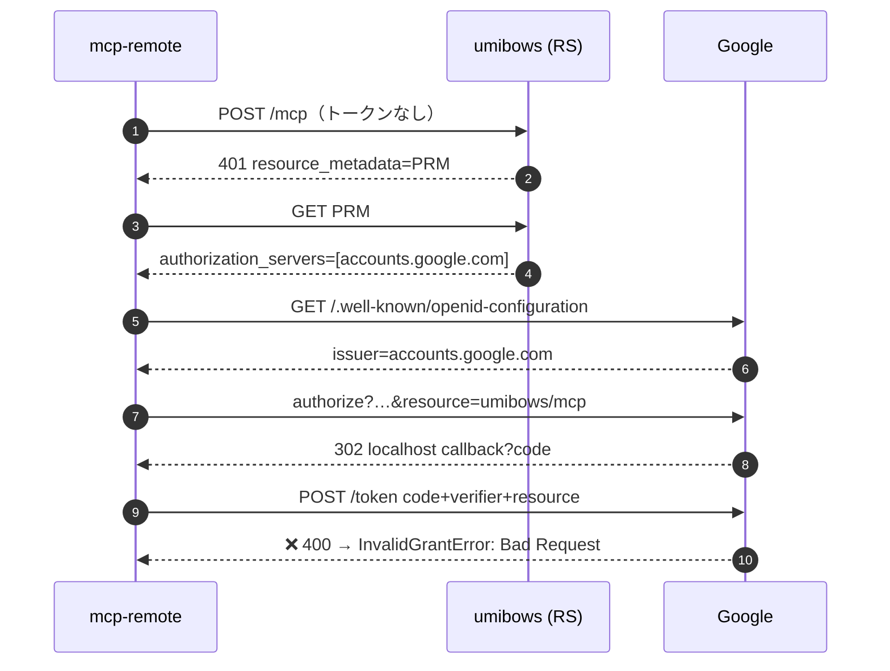
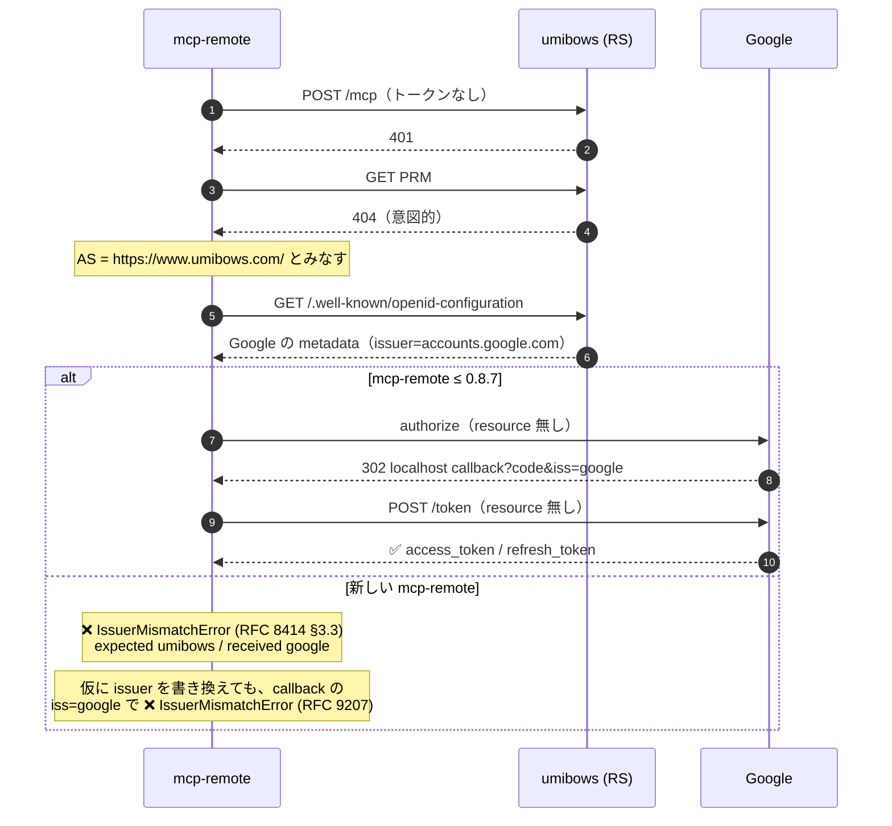
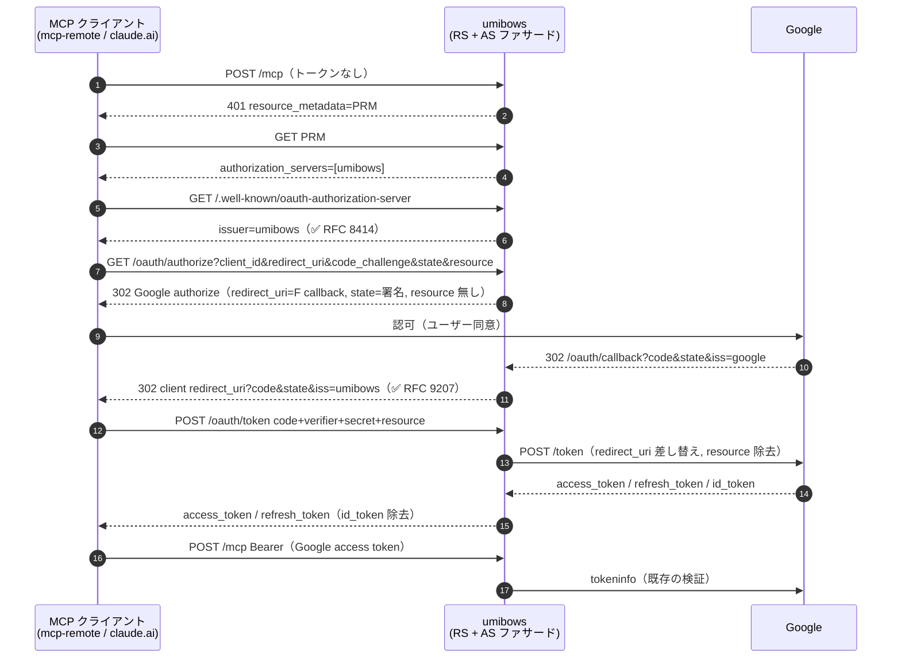

# mahjong-nanikiru — Remote MCP の OAuth AS ファサード 設計

`remote-mcp-google-oauth.md` §7.3 のワークアラウンド（PRM 404 + `/.well-known/openid-configuration` で
Google metadata をそのまま返す）を廃止し、**umibows を Google に中継する薄い Authorization Server（AS）ファサード**にする。

> ステータス: **設計合意済み・未実装**

---

## 1. 背景 — なぜ今のワークアラウンドが壊れたか

mcp-remote 0.9.0（2026-09-11）以降、同梱 MCP SDK が issuer を 2 箇所で検証する。

| 検証                                     | 内容                                                               | 現状                                                             |
| ---------------------------------------- | ------------------------------------------------------------------ | ---------------------------------------------------------------- |
| RFC 8414 §3.3（metadata）                | metadata の `issuer` == discovery に使った URL                     | `https://www.umibows.com/` から取って `accounts.google.com` → ❌ |
| RFC 9207（authorization response `iss`） | callback に `iss` があれば metadata の `issuer` と**完全一致**必須 | Google は `iss=https://accounts.google.com` を付ける → ❌        |

- 後者は metadata 側の `authorization_response_iss_parameter_supported` を消しても回避できない（`iss` が存在すれば常に比較される）。
- mcp-remote の CLI に issuer 検証をスキップするフラグは無い。
- そのため一時的に Claude Desktop 側を `mcp-remote@0.8.7` に固定している。これを解消するのが本設計の目的。

### 1.1 実際に出た MCP エラー（Claude Desktop のログ）

出典は `~/Library/Logs/Claude/mcp-server-mahjong-nanikiru*.log`。スタックトレースは省略し、パスは `~` に置き換えている。

#### (a) 2026-09-11〜 `IssuerMismatchError`（RFC 8414 §3.3）— 今回の移行のきっかけ

バージョン固定をしていない `npx mcp-remote` が新しい版（ログ上の clientInfo は `mcp-remote 0.10.0`）に上がった直後から出始めた。

```text
[31292] Proactive token refresh failed, falling back to the stored token
[31292] Error from remote server: IssuerMismatchError: Issuer mismatch in authorization server metadata (RFC 8414 §3.3): expected "https://www.umibows.com/", received "https://accounts.google.com"
    at discoverAuthorizationServerMetadata (~/.npm/_npx/…/mcp-remote/dist/chunk-FY2H35G7.js:28274:135)
    at async discoverOAuthServerInfo (…)
    at async authInternal (…)
    at async handleOAuthUnauthorized (…)
```

翌日（2026-09-12）の再起動時は接続自体ができなくなった。

```text
[59155] Discovering OAuth server configuration...
[59155] Connecting to remote server: https://www.umibows.com/api/mcp/mahjong-nanikiru/mcp
[59155] Proactive token refresh failed, falling back to the stored token
[59155] Connection error: IssuerMismatchError: Issuer mismatch in authorization server metadata (RFC 8414 §3.3): expected "https://www.umibows.com/", received "https://accounts.google.com"
  { kind: 'metadata', expected: 'https://www.umibows.com/', received: 'https://accounts.google.com' }
[59155] Fatal error: IssuerMismatchError: …（同上）
[mahjong-nanikiru] [error] Couldn't start for Cowork and Code sessions. Error: Connection closed
```

読み取れること:

- `expected` が `https://www.umibows.com/`（末尾スラッシュ付き）なのは、PRM が 404 なので SDK が「MCP サーバー URL の origin = AS」とみなしてフォールバックしたため。
- 既存トークンを持っていても、refresh で AS metadata の再 discovery が走った時点で落ちる。キャッシュ済みのトークンでは逃げられない。
- 起動に失敗すると Cowork / Claude Code の共有プールからも外れる（`Couldn't start for Cowork and Code sessions`）。

#### (b) `IssuerMismatchError`（RFC 9207）— 未観測。issuer だけ書き換える案で出るはずのもの

同じ版の SDK の検証コードは次のとおり。

```js
function validateAuthorizationResponseIssuer({ iss, expectedIssuer, issParameterSupported }) {
  if (expectedIssuer === void 0) return;
  if (iss === void 0) {
    if (issParameterSupported)
      throw new IssuerMismatchError("authorization_response", expectedIssuer, void 0);
    return;
  }
  if (iss !== expectedIssuer)
    throw new IssuerMismatchError("authorization_response", expectedIssuer, iss);
}
```

metadata の `issuer` を umibows に書き換えて (a) を回避しても、Google の callback には `iss=https://accounts.google.com` が付く。そのため次のエラーになる（メッセージはコードから組み立てたもの）。

```text
IssuerMismatchError: Issuer mismatch in authorization response (RFC 9207): expected "https://www.umibows.com", received "https://accounts.google.com"
```

`iss` が付いていれば `issParameterSupported` に関係なく比較される。そのため metadata をいじる案はすべて行き止まりになり、**callback を自分で受けて `iss` を付け直す**ファサードが必要になる。

#### (c) 過去の経緯（2026-08-23）— ワークアラウンドを入れた理由

| エラー                                                                          | 状況                                           | 原因 → 対処                                                                                                                                         |
| ------------------------------------------------------------------------------- | ---------------------------------------------- | --------------------------------------------------------------------------------------------------------------------------------------------------- |
| `Error: Incompatible auth server: does not support dynamic client registration` | `--static-oauth-client-info` を付けずに接続    | Google は DCR 非対応 → client_id / secret を静的に渡す                                                                                              |
| `Authorization error: InvalidGrantError: Bad Request`（`finishAuth` 中）        | PRM → `accounts.google.com` 直指定で code 交換 | SDK が token リクエストに `resource=` を付け、Google が 400 を返す → PRM を 404 にして `resource` を送らせない（`remote-mcp-google-oauth.md` §7.3） |

つまり「`resource` を消すために PRM を 404 にした」結果、SDK は umibows を AS とみなすようになった。そこに issuer 検証が加わって壊れた。

### 1.2 採らなかった案

| 案                                                                             | 不採用理由                                                                                                         |
| ------------------------------------------------------------------------------ | ------------------------------------------------------------------------------------------------------------------ |
| mcp-remote のバージョン固定                                                    | 固定し続けたくない（セキュリティ修正も取り込めない）                                                               |
| PRM → `accounts.google.com` 直指定 + mcp-remote `--disable-resource-parameter` | Desktop は直るが、claude.ai connector は常に `resource` を送る（Google token endpoint が 400）ため cowork が壊れる |
| Desktop 専用の MCP パスを分ける                                                | 認証経路が 2 系統になり運用が複雑                                                                                  |
| issuer だけ umibows に書き換え                                                 | callback の `iss=accounts.google.com` で RFC 9207 検証に落ちる                                                     |
| token エンドポイントだけプロキシ（authorize は Google 直）                     | 同上（callback の `iss` が Google のまま）                                                                         |
| MCP SDK `ProxyOAuthServerProvider`                                             | express 前提で Next.js route handler で使えない / `resource` を素通しする / SDK v2 で deprecated                   |
| 自前トークン発行（FastMCP / Cloudflare workers-oauth-provider 方式）           | 上流トークンの保管に KV が必要。シングルユーザー・DB 無しの本構成には過剰                                          |

---

## 2. 方針

- **トークンは Google のものを素通し**（自前発行しない）。MCP 側の検証（tokeninfo で aud / email_verified / email allowlist）は変更なし。
- **state はステートレス**（HMAC 署名 + 10 分 TTL）。ストレージ不要。
- **PKCE は素通し**（クライアントの `code_challenge` を Google に渡し、`code_verifier` は token で Google が検証）。
- **client_secret はサーバーに持たない**（クライアントが送ってきたものを Google に転送）。漏洩した refresh_token をファサード経由で使われるのを防ぐ。
- **DCR はしない**。client_id は `GOOGLE_OAUTH_CLIENT_IDS` の静的 allowlist のみ。DCR が無いので MCP Security Best Practices の per-client consent 画面は不要（confused deputy の前提条件を満たさない）。
- `resource` パラメータは authorize / token とも**ファサードで落とす**。
- Google クライアントは **既存の Web 型 1 つに統合**（Desktop 型は https の redirect URI を登録できないため）。
- 対象 origin は **本番（`https://www.umibows.com`）とローカル開発のみ**。Preview URL は Google に redirect URI を登録できないので非対応。

---

## 3. エンドポイント

issuer = `https://www.umibows.com`（末尾スラッシュ無し。PRM の `authorization_servers[0]`、metadata の `issuer`、callback の `iss` で**同一文字列**を使う）。

| Method | Path                                                                 | ファイル                                                                                         | 役割                              |
| ------ | -------------------------------------------------------------------- | ------------------------------------------------------------------------------------------------ | --------------------------------- |
| GET    | `/.well-known/oauth-protected-resource/api/mcp/mahjong-nanikiru/mcp` | `app/.well-known/oauth-protected-resource/api/mcp/mahjong-nanikiru/mcp/route.ts`（404 → 正規化） | RFC 9728 PRM                      |
| GET    | `/.well-known/oauth-authorization-server`                            | `app/.well-known/oauth-authorization-server/route.ts`（新規）                                    | RFC 8414 AS metadata              |
| GET    | `/api/mcp/mahjong-nanikiru/oauth/authorize`                          | `app/api/mcp/mahjong-nanikiru/oauth/authorize/route.ts`（新規）                                  | Google authorize へ中継           |
| GET    | `/api/mcp/mahjong-nanikiru/oauth/callback`                           | `app/api/mcp/mahjong-nanikiru/oauth/callback/route.ts`（新規）                                   | Google から戻り、クライアントへ   |
| POST   | `/api/mcp/mahjong-nanikiru/oauth/token`                              | `app/api/mcp/mahjong-nanikiru/oauth/token/route.ts`（新規）                                      | Google token へ中継               |
| —      | `/.well-known/openid-configuration`                                  | `app/.well-known/openid-configuration/route.ts`                                                  | **削除**（issuer が衝突するため） |

- `/api/mcp/` と `/.well-known/` は `middleware.ts` の Basic 認証除外に既に入っているので middleware は変更しない。
- `oauth/` は静的セグメントなので既存の `[transport]` と衝突しない。
- 共通ロジックは `lib/mcp/oauth-facade/` に置く（`config.ts` / `state.ts` / `redirect-uri.ts` / `client-auth.ts`）。新規依存は無し（`node:crypto` のみ）。

### 3.1 PRM

```json
{
  "resource": "https://www.umibows.com/api/mcp/mahjong-nanikiru/mcp",
  "authorization_servers": ["https://www.umibows.com"],
  "scopes_supported": ["openid", "email"],
  "bearer_methods_supported": ["header"]
}
```

`mcp-handler` の `protectedResourceHandler` / `metadataCorsOptionsRequestHandler` を使う。

### 3.2 AS metadata

```json
{
  "issuer": "https://www.umibows.com",
  "authorization_endpoint": "https://www.umibows.com/api/mcp/mahjong-nanikiru/oauth/authorize",
  "token_endpoint": "https://www.umibows.com/api/mcp/mahjong-nanikiru/oauth/token",
  "response_types_supported": ["code"],
  "grant_types_supported": ["authorization_code", "refresh_token"],
  "code_challenge_methods_supported": ["S256"],
  "token_endpoint_auth_methods_supported": ["client_secret_basic", "client_secret_post"],
  "scopes_supported": ["openid", "email"],
  "authorization_response_iss_parameter_supported": true
}
```

`registration_endpoint` は載せない（DCR 非対応を明示）。CORS `*`。

### 3.3 `/oauth/authorize`

1. 検証（**どれか失敗したら 400 の HTML を返し、決してリダイレクトしない** = open redirect 対策）
   - `response_type == "code"`
   - `client_id ∈ GOOGLE_OAUTH_CLIENT_IDS`
   - `redirect_uri` が allowlist に一致（§4）
   - `code_challenge` があり `code_challenge_method == "S256"`
2. 署名付き state を作る（§5）。中身はクライアントの `redirect_uri` と `state`、`client_id`、有効期限
3. Google にリダイレクトする（302）。`https://accounts.google.com/o/oauth2/v2/auth` に次のパラメータを付ける
   - `client_id`：クライアントから受け取った値
   - `redirect_uri`：`{ISSUER}/api/mcp/mahjong-nanikiru/oauth/callback`
   - `response_type=code`
   - `scope=openid email`：クライアントの scope は無視して固定
   - `code_challenge` / `code_challenge_method=S256`：受け取った値をそのまま渡す
   - `state`：手順 2 の署名付き state
   - `access_type=offline` と `prompt=consent`：refresh_token を確実に得るため
   - `resource` は付けない

### 3.4 `/oauth/callback`

1. `state` を検証（HMAC は `timingSafeEqual`、`exp`）。失敗 → 400 HTML（リダイレクトしない）
2. Google が `iss` を付けていれば `https://accounts.google.com` であることを確認（mix-up 対策）
3. state 内のクライアント `redirect_uri` へ 302:
   - 成功: `code`, `state=<クライアントの state>`, `iss=<ISSUER>`
   - Google がエラーを返した場合: `error`, `error_description`, `state`, `iss`（RFC 9207 はエラー時も `iss` 必須）

### 3.5 `/oauth/token`

- `application/x-www-form-urlencoded` のみ受け付ける。`Cache-Control: no-store`
- クライアント認証は 2 方式とも受ける
  - `client_secret_basic`：Authorization ヘッダを base64 デコードしたあと、さらに form-url デコードする（RFC 6749 §2.3.1）
  - `client_secret_post`：body の `client_id` / `client_secret` を使う
- 入力の検証
  - `client_id ∈ GOOGLE_OAUTH_CLIENT_IDS`
  - `grant_type ∈ {authorization_code, refresh_token}`。それ以外は `unsupported_grant_type`
  - `authorization_code` のときは `code` / `code_verifier` / `redirect_uri` が必須。`redirect_uri` は §4 の allowlist に一致すること
- Google（`https://oauth2.googleapis.com/token`）に POST で転送する
  - `authorization_code`：`grant_type`, `code`, `code_verifier`, `client_id`, `client_secret` に、`redirect_uri={CALLBACK}`（差し替え）を付ける
  - `refresh_token`：`grant_type`, `refresh_token`, `client_id`, `client_secret`
  - `resource` と `scope` は転送しない。クライアントのヘッダも転送しない
  - タイムアウトは 8 秒（claude.ai 側の上限が 10 秒）
- レスポンス
  - Google のステータスコードと JSON をそのまま返す。ただし `id_token` は除く（`iss=accounts.google.com` の ID トークンを渡すと、OIDC 検証するクライアントで不整合になるため）

---

## 4. redirect_uri allowlist

`new URL()` でパースして判定（文字列 prefix 判定はしない）。

| 対象                     | 条件                                                                                                                             |
| ------------------------ | -------------------------------------------------------------------------------------------------------------------------------- |
| claude.ai / cowork       | `https://claude.ai/api/mcp/auth_callback` と完全一致                                                                             |
| mcp-remote / Claude Code | `protocol === "http:"`、hostname が `localhost` / `127.0.0.1` / `[::1]`、port 任意、path 任意、`username`/`password`/`hash` が空 |

- `http://localhost:1@evil.com/` のような userinfo 偽装は URL パース後の hostname 判定と userinfo 空チェックで弾く。
- mcp-remote の callback は `http://localhost:{port}/oauth/callback`（Windows は `127.0.0.1`）。
- 追加が必要になったら env `MCP_OAUTH_EXTRA_REDIRECT_URIS`（カンマ区切り・完全一致）で足せるようにする。

## 5. 署名付き state

```
state = base64url(JSON payload) + "." + base64url(HMAC-SHA256(OAUTH_STATE_SECRET, payloadPart))
payload = { v: 1, cid: client_id, ru: client_redirect_uri, cs: client_state | null, exp: now + 600, n: random 16 bytes }
```

- 単回使用の強制はしない（ストレージ無し）。Google の code が単回使用 + PKCE で code の再利用は防げる。残るのはログイン CSRF だが、Google 直結時と同等で `prompt=consent` が緩和する。
- `OAUTH_STATE_SECRET` は 32 byte 以上のランダム値。ローテーションで発行中のフローが失敗するだけ（10 分以内に再試行で回復）。

---

## 6. 環境変数

| 変数                            | 変更       | 用途                                                                                                |
| ------------------------------- | ---------- | --------------------------------------------------------------------------------------------------- |
| `OAUTH_STATE_SECRET`            | **新規**   | state の HMAC 鍵                                                                                    |
| `MCP_RESOURCE_ORIGIN`           | 用途拡張   | issuer / callback の origin。未設定時は `https://www.umibows.com`（Preview の Host から推定しない） |
| `GOOGLE_OAUTH_CLIENT_IDS`       | 値の変更   | 移行後は Web 型 client_id のみ                                                                      |
| `MCP_OAUTH_EXTRA_REDIRECT_URIS` | 新規・任意 | §4 の追加 redirect_uri                                                                              |
| `MCP_ALLOWED_EMAILS`            | 変更なし   |                                                                                                     |

ローカル開発: `MCP_RESOURCE_ORIGIN=http://localhost:3000` + Google クライアントに `http://localhost:3000/api/mcp/mahjong-nanikiru/oauth/callback` を登録。

---

## 7. シーケンスの変遷

| 段階 | 構成                                                                            | 結果                                                                      |
| ---- | ------------------------------------------------------------------------------- | ------------------------------------------------------------------------- |
| v1   | PRM → `accounts.google.com` を直接指す                                          | token 交換で `resource` が付き、Google が 400（§1.1 (c)）                 |
| v2   | PRM 404 + `/.well-known/openid-configuration` で Google metadata をそのまま返す | mcp-remote 0.8.7 までは動く。新しい版では issuer 検証に落ちる（§1.1 (a)） |
| v3   | umibows が AS ファサードになる（本設計）                                        | issuer / `iss` / `resource` の問題をまとめて解消                          |

### 7.1 v1: PRM → Google 直（2026-08-23 に断念）



### 7.2 v2: PRM 404 + openid-configuration プロキシ（〜2026-09-11）

PRM が無いので SDK は「MCP サーバーの origin が AS」とフォールバックし、`resource` を送らなくなる。その代わりに、discovery に使った URL（umibows）と metadata の `issuer`（Google）がずれる。



### 7.3 v3: AS ファサード（本設計、mcp-remote / cowork 共通）



---

## 8. テスト（`tests/oauth/*.test.ts`、fetch は `vi.spyOn(globalThis, "fetch")`）

- **state**：署名と検証が往復できる。改ざんされたもの・期限切れ・別の鍵で署名されたものを拒否する
- **redirect_uri**：次の値を正しく判定する
  - 受け入れる：claude.ai の完全一致、`localhost` / `127.0.0.1` / `[::1]` の任意ポート
  - 拒否する：userinfo 偽装、`https://localhost`、`claude.ai` の別パス、`javascript:`
- **authorize**
  - 不正な入力では 400 を返し、`Location` ヘッダが無い
  - 正常時は 302 で、Google 向けパラメータが正しい（`resource` が無い、`redirect_uri` が差し替わっている、`scope` が固定されている）
- **callback**
  - 成功時もエラー時も `iss` に umibows が付き、クライアントの `state` がそのまま返る
  - state が不正なら 400 で、リダイレクトしない
  - Google の `iss` が想定外なら拒否する
- **token**
  - basic 認証のヘッダを正しくデコードできる
  - `resource` と `scope` が転送されない。`redirect_uri` が差し替わる。`id_token` が除去される
  - 未対応の `grant_type`、許可していない `client_id`、allowlist 外の `redirect_uri` は拒否する
- **整合性**：PRM の `authorization_servers[0]`、metadata の `issuer`、callback で付ける `iss` が同一文字列

**E2E（デプロイ後に手動）**

- 最新の mcp-remote で接続できる（バージョン固定なし）
- cowork で再接続できる
- 1 時間以上たってから refresh_token による更新が成功する

---

## 9. 移行手順

1. Google Cloud Console で、Web 型クライアントの承認済みリダイレクト URI に `https://www.umibows.com/api/mcp/mahjong-nanikiru/oauth/callback` を追加する。あわせて、OAuth 同意画面が「本番」ステータスになっていることを確認する（`remote-mcp-google-oauth.md` §7.5）
2. Vercel に `OAUTH_STATE_SECRET` を設定する
3. デプロイする。`openid-configuration` の削除も同じデプロイに含める
4. Claude Desktop を切り替える
   - `claude_desktop_config.json` で `mcp-remote@0.8.7` を `mcp-remote` に戻す（固定をやめる）
   - `--static-oauth-client-info` を Web 型クライアントの値に差し替える
   - `~/.mcp-auth/` の該当キャッシュを削除し、Claude Desktop を再起動する
5. cowork で connector を再接続する（client_id / secret は既存の Web 型のまま）
6. 動作を確認したら、`GOOGLE_OAUTH_CLIENT_IDS` から Desktop 型の client_id を外し、Google 側の Desktop 型クライアントと claude.ai 用の旧コールバック URI を削除する
7. `remote-mcp-google-oauth.md` の §7.3 / §8 を更新し、本ドキュメントを参照させる

**ロールバック**

- デプロイを revert すれば、`openid-configuration` 方式に戻る
- Desktop はもう一度 `mcp-remote@0.8.7` に固定する

---

## 10. スコープ外

- 共有トークン（`?key=` / `MAHJONG_MCP_TOKEN`）の撤去（`remote-mcp-google-oauth.md` §10 で別途）
- DCR と per-client consent 画面（DCR を足す場合は consent 画面が必須になる）
- 自前トークン発行・トークン失効（revocation）エンドポイント
- Preview デプロイでの OAuth 動作
